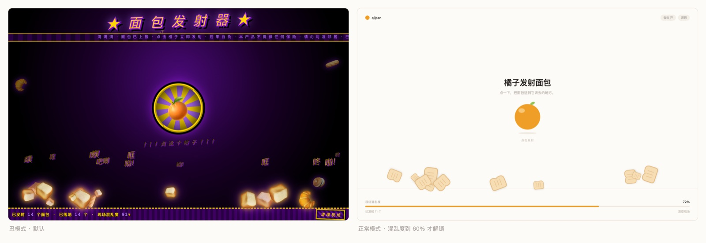

# ojipan

一个故意做丑的单页玩具：点橘子，面包飞出去。纯静态单文件，零依赖零构建，打开就能玩。



在线玩：<https://ojipan.attilio.cc>

## 跑起来

双击 `index.html` 就行。想按真实路径跑：

```bash
python3 -m http.server 8000
```

然后开 <http://localhost:8000>。

## 两副面孔

默认那套丑得理直气壮：黑底、紫金、Comic Sans、彩虹放射橙子。

另一套是干净的奶油白，橘子变成一整颗圆，面包换成吐司块。它不是菜单里点出来的，得玩出来。

| 阶段 | 触发 | 发生什么 |
| --- | --- | --- |
| 丑模式 | 混乱度到 60% | 弹一个同样丑的窗，问你要不要换个正常点的 |
| 点了「不换」 | — | 弹窗不再骚扰，底栏多一个「切正常模式」随时能进 |
| 正常模式 | 混乱度满 100% | 抖一下崩回丑的，地上所有面包掉出屏幕 |

崩回去是一次性的，一轮只走一遍，清空现场会把整个循环重置。

## 怎么玩

| 操作 | 结果 |
| --- | --- |
| 点橘子 | 发射 1 个面包，35% 概率一次连发 3 个 |
| 等它落地 | 弹两下停住；丑模式下顺手甩一句「咚」「啪」「吧唧」 |
| 清空现场 | 清空面包，计数和触发标记一起归零 |

混乱度按落地数量算，16 个满 100%。60% 差不多在第 10 个。

## URL 参数

截图用的，正常玩不用带。

| 参数 | 作用 |
| --- | --- |
| `?shot=1` | 快照模式。同步把物理跑完再渲染，给 headless 截图 |
| `?shot=1&mode=clean` | 直接截正常模式 |
| `?shot=1&modal=1` | 直接截那个弹窗 |

## 已知问题

- 音效是方波扫频，难听是设计的一部分。
- 面包只落在屏幕底部，天花板不接客。
- 窄屏能跑但没有专门适配，手机上橘子显得特别大。
- 正常模式的面包停在一条线上，不会互相堆叠。

## License

MIT
